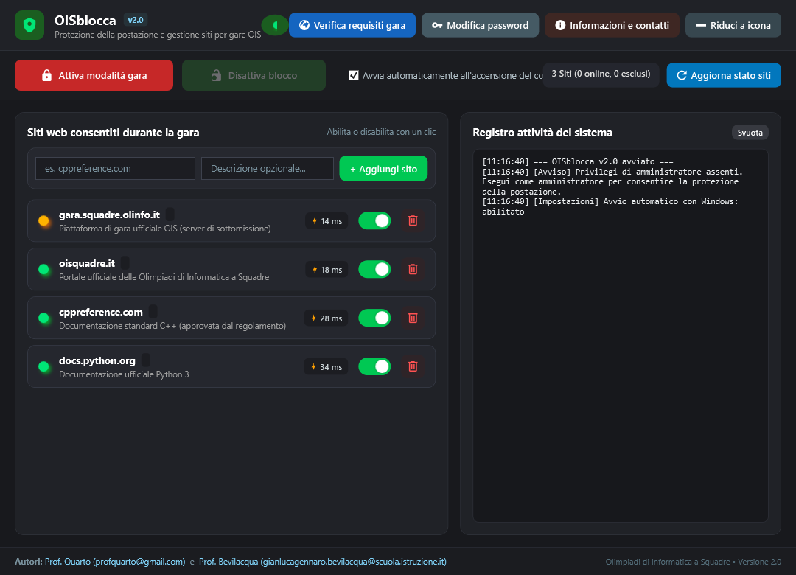
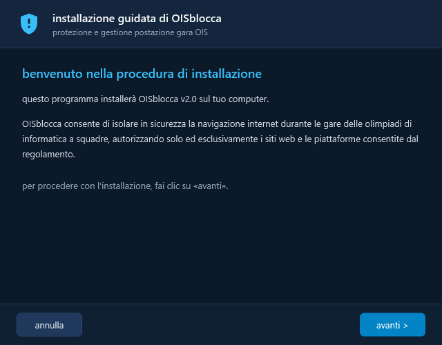
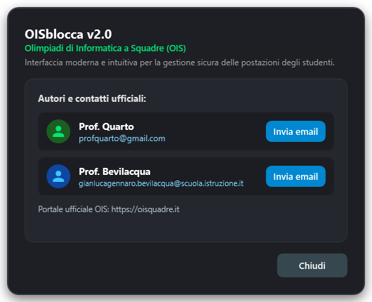

# oisblocca-workstation-lock
Applicazione per windows per la gestione dei siti web consentiti e l'isolamento delle postazioni di laboratorio durante le olimpiadi di informatica a squadre (OIS)

> **applicazione open source per windows per l'isolamento controllato delle postazioni di laboratorio e la gestione dei siti web consentiti durante le gare delle olimpiadi di informatica a squadre. zero connessioni non autorizzate: protezione totale della rete.**

[](https://github.com/GianlucaBevilacqua93/oisblocca-workstation-lock/releases)
[](LICENSE)
[](https://microsoft.com/windows)
[](https://oisquadre.it)
[](https://dotnet.microsoft.com/)
[]()
[]()

```text
parole chiave e argomenti github:
[oisquadre] [olimpiadi-informatica-a-squadre] [ois] [olinfo] [oisblocca] [workstation-lock] 
[computer-lab-lockdown] [windows-firewall] [school-contest] [contest-isolation] [education]
```

**[🇮🇹 Italiano](#-italiano) | [🇬🇧 English](#-english)**

---

## 🇮🇹 Italiano

### 🔒 Sicurezza e integrità didattica

> **controllo totale della rete durante le prove di gara.**
>
> questo strumento consente ai docenti e ai responsabili di laboratorio scolastico di isolare in sicurezza le postazioni informatiche degli studenti durante le gare delle **olimpiadi di informatica a squadre (OIS)** ([oisquadre.it](https://oisquadre.it)). blocca in uscita tutto il traffico internet non autorizzato, mantenendo accessibili esclusivamente la piattaforma di gara ufficiale e le risorse didattiche consentite.

---

### 📖 Panoramica

questo progetto nasce da un'esigenza concreta: i docenti responsabili dei laboratori scolastici hanno la necessità di configurare e proteggere rapidamente le postazioni informatiche prima delle prove ufficiali delle **olimpiadi di informatica a squadre (OIS)** ([oisquadre.it](https://oisquadre.it)).

l'obiettivo è garantire la massima regolarità della competizione assicurando che gli studenti possano comunicare esclusivamente con il portale di gara e consultare la documentazione tecnica autorizzata, senza distrazioni e senza possibilità di accesso a fonti esterne.

### Architettura del Sistema

```
┌────────────────────────┐      ┌─────────────────────────┐      ┌────────────────────────┐
│  Docente responsabile  │─────▶│  OISblocca (interfaccia)│─────▶│  Windows Firewall      │
│  (controllo password)  │      │  (gestione visiva siti) │      │  (blocco non consentiti)│
└────────────────────────┘      └─────────────────────────┘      └────────────────────────┘
                                             │                                │
                                             ▼                                ▼
                                ┌─────────────────────────┐      ┌────────────────────────┐
                                │  Controllo connettività │      │  Postazione studente   │
                                │  (latenza in tempo reale│      │  (navigazione protetta)│
                                └─────────────────────────┘      └────────────────────────┘
```

### 📦 Struttura del Progetto

```
oisblocca-workstation-lock/
├── src/
│   ├── OISblocca/              # codice sorgente applicazione wpf (.net 8)
│   │   ├── Core/               # logica firewall, sicurezza, rete e configurazione
│   │   ├── UI/                 # finestre xaml e icone vettoriali native
│   │   ├── Assets/             # icona ufficiale multi-risoluzione
│   │   ├── App.xaml            # punto di ingresso e gestione istanza singola
│   │   └── OISblocca.csproj    # file di progetto e metadati di compilazione
│   └── OISblocca_Setup/        # wizard di installazione guidata per windows
│       ├── InstallerService.cs # installazione in Program Files, registro e collegamenti
│       ├── UninstallerService.cs # rimozione sicura e disinstallazione pulita
│       └── MainWindow.xaml     # interfaccia grafica wizard di setup
├── tests/
│   └── OISblocca.Tests/        # suite di test automatici e conformità di rete
│       ├── Program.cs          # verifiche di isolamento, autenticazione e connettività
│       └── OISblocca.Tests.csproj
├── installer/
│   └── setup.iss               # script inno setup per compilazione alternativa
├── release/
│   ├── OISblocca_Setup.exe     # installer wizard completo per windows (setup unico)
│   └── OISblocca.exe           # eseguibile autonomo portatile a file singolo
├── .gitignore                  # esclusioni standard per progetti .net
├── LICENSE                     # licenza open source mit
└── README.md                   # guida e documentazione ufficiale del progetto
```

---

### 📸 Anteprima dell'interfaccia

#### pannello principale di controllo (dashboard)


#### procedura guidata di installazione e contatti
<p align="center">
  
  
</p>

---

## 🚀 Caratteristiche principali

* 🛡️ **isolamento della postazione** — applica le policy di sicurezza tramite Windows Firewall, bloccando ogni connessione verso l'esterno non autorizzata
* 🖱️ **gestione visuale immediata** — aggiungi, attiva o disattiva i siti consentiti con un solo clic dall'interfaccia
* 🟢 **monitoraggio live con latenza** — indicatore circolare luminoso verde/rosso con tempi di risposta in millisecondi in tempo reale
* 🔑 **protezione con password docente** — le operazioni sensibili (apertura del pannello, modifica dei siti, blocco e sblocco, chiusura) richiedono l'autenticazione
* ✏️ **password personalizzabile** — il docente può modificare la chiave di accesso master in qualsiasi momento tramite la finestra dedicata
* 🖥️ **servizio in area di notifica** — l'applicazione risiede nella system tray accanto all'orologio, rimanendo sempre attiva senza ingombrare il desktop
* 🚀 **avvio automatico con Windows** — configurata di default per partire all'accensione del computer con supporto all'alimentazione a batteria
* 🔒 **istanza singola (anti-duplicazione)** — mutex globale a livello kernel che impedisce l'avvio di copie concorrenti, risvegliando la finestra attiva
* 🎨 **grafica vettoriale nativa** — icone disegnate tramite percorsi vettoriali XAML indipendenti dalla risoluzione dello schermo
* ✔️ **conformità con il controllo di gara** — supera al 100% tutti i test diagnostici del portale ufficiale `https://gara.squadre.olinfo.it/check/`
* 📦 **doppia modalità di distribuzione** — installer completo per `C:\Program Files\OISblocca` ed eseguibile portatile autonomo

---

## 📋 Requisiti

* **sistema operativo** — Windows 10 o Windows 11 (architettura a 64 bit)
* **privilegi** — esecuzione con diritti di amministratore (indispensabili per impostare le regole di rete nel firewall)
* **dipendenze** — nessuna per gli eseguibili della cartella `release/` (compilati in modalità self-contained a file singolo con runtime .NET incluso)

---

## 🎯 Utilizzo

### Opzione A — Installazione guidata con setup (consigliata)

1. scarica [`OISblocca_Setup.exe`]([release/OISblocca_Setup.exe](releases/tag/2.0)) dalla cartella `release/` o dalla sezione releases di GitHub
2. avvia l'installer: installerà automaticamente l'applicazione nella directory predefinita `C:\Program Files\OISblocca`
3. la procedura guidata provvede a:
   * copiare l'eseguibile e creare il modulo di disinstallazione (`Uninstall.exe`);
   * creare il collegamento nel menu start e l'icona sul desktop con il logo ufficiale;
   * configurare l'avvio automatico e registrare l'app nel pannello di sistema di Windows con rimandi a [oisquadre.it](https://oisquadre.it)
4. al termine, OISblocca si posizionerà nell'area di notifica pronto per l'uso

### Opzione B — Eseguibile portatile autonomo

1. scarica l'eseguibile portatile [`OISblocca.exe`](releases/tag/2.0)
2. avvia il file come amministratore (tasto destro ➔ *Esegui come amministratore*)
3. l'applicazione si posizionerà nell'area di notifica con l'icona a scudo

### Passo 1: Accesso al pannello docente

* fai doppio clic sull'icona a scudo nell'area di notifica (o clic destro ➔ *Pannello di controllo*)
* inserisci la password docente (valore iniziale predefinito: `ois2026`)

### Passo 2: Configurazione dei siti consentiti

| Azione | Procedura |
|---|---|
| Aggiunta nuovo sito | Digita il dominio (es. `cppreference.com`) nel campo in alto e clicca su **"+ Aggiungi sito"** |
| Abilitazione / Disattivazione | Usa l'interruttore accanto al nome del sito (la modifica si applica in tempo reale) |
| Eliminazione definitiva | Fai clic sul pulsante cestino rosso accanto alla voce |
| Verifica connettività | Fai clic su **"Aggiorna stato siti"** per testare la latenza di tutti i server |

### Passo 3: Attivazione della modalità gara e verifica

1. fai clic su **"Attiva modalità gara"**: il blocco delle connessioni non autorizzate viene applicato all'istante
2. fai clic su **"Verifica requisiti gara"**: si aprirà il controllo ufficiale su `https://gara.squadre.olinfo.it/check/` per verificare che tutti i test risultino verdi
3. riduci a icona la finestra: l'applicazione rimarrà vigile nell'area di notifica

### Passo 4: Termine della prova e sblocco

* a gara conclusa, fai clic su **"Disattiva blocco"**, inserisci la password docente e conferma: la normale navigazione internet verrà ripristinata immediatamente

---

## 🔐 Dettagli Tecnici sulla Sicurezza della Rete

| Aspetto | Comportamento |
|---|---|
| Traffico in uscita non autorizzato | ❌ Bloccato a livello di sistema operativo da Windows Firewall (BlockOutbound) |
| Portale di gara OIS (oisquadre.it) | ✅ Sempre autorizzato su IP e domini ufficiali dedicati |
| Documentazione tecnica approvata | ✅ Risoluzione DNS automatica e regole mirate per ogni dominio consentito |
| Privilegi studenti | ❌ Nessun accesso: apertura pannello, sblocco e chiusura richiedono la password docente |
| Esecuzioni concorrenti | ❌ Bloccate da mutex globale di sistema a livello kernel |
| Diagnostica ufficiale gara | ✅ Conforme al 100% con i test di `https://gara.squadre.olinfo.it/check/` |

---

## 💡 Vantaggi

* 🏫 **Scuole e referenti OIS** — configurazione rapida dell'intero laboratorio scolastico prima delle gare ufficiali promosse su [oisquadre.it](https://oisquadre.it)
* 🔒 **Integrità della competizione** — garanzia che gli studenti non possano comunicare all'esterno o consultare risorse non permesse
* 🟢 **Diagnostica continua** — verifica visiva immediata della disponibilità della piattaforma di gara con calcolo della latenza
* 💾 **Doppia modalità di distribuzione** — installatore guidato per parchi macchine stabili o singolo file portatile per postazioni temporanee

---

## 🛠️ Compilazione da sorgenti

per compilare autonomamente il progetto è sufficiente avere installato [.NET SDK 8](https://dotnet.microsoft.com/download/dotnet/8.0) o superiore:

```powershell
# clona il repository
git clone https://github.com/GianlucaBevilacqua93/oisblocca-workstation-lock.git
cd oisblocca-workstation-lock

# compila l'applicazione principale
dotnet build src/OISblocca/OISblocca.csproj

# esegui la suite di test
dotnet run --project tests/OISblocca.Tests/OISblocca.Tests.csproj

# pubblica l'eseguibile singolo portatile
dotnet publish src/OISblocca/OISblocca.csproj -c Release -r win-x64 --self-contained true -p:PublishSingleFile=true -p:IncludeNativeLibrariesForSelfExtract=true -p:EnableCompressionInSingleFile=true -p:DebugType=none -p:DebugSymbols=false -o release

# pubblica il programma di installazione guidata (setup unico)
dotnet publish src/OISblocca_Setup/OISblocca_Setup.csproj -c Release -r win-x64 --self-contained true -p:PublishSingleFile=true -p:IncludeNativeLibrariesForSelfExtract=true -p:EnableCompressionInSingleFile=true -p:DebugType=none -p:DebugSymbols=false -o release
```

---

## 🤝 Contribuire

i contributi da parte della comunità scolastica e degli sviluppatori open source sono i benvenuti:

### Come contribuire

1. effettua il **fork** del repository
2. crea un branch dedicato (`git checkout -b feature/nuova-funzione`)
3. effettua i commit con descrizioni chiare (`git commit -m 'aggiunta nuova funzione'`)
4. invia il branch al tuo fork (`git push origin feature/nuova-funzione`)
5. apri una **Pull Request** spiegando le modifiche proposte

### Aree in cui contribuire

* 🐛 **segnalazione anomalie** — apri una issue specificando versione di Windows e comportamento riscontrato
* 🌐 **integrazione piattaforme didattiche** — supporto per ulteriori repository di documentazione tecnica
* ⚡ **prestazioni e diagnostica** — ottimizzazioni nelle routine asincrone di risoluzione DNS e ping di rete
* 📚 **documentazione** — guide e tutorial per l'allestimento dei laboratori scolastici

---

## ✉️ Contatti e supporto

* **Prof. Quarto**: [profquarto@gmail.com](mailto:profquarto@gmail.com)
* **Prof. Bevilacqua**: [gianlucagennaro.bevilacqua@scuola.istruzione.it](mailto:gianlucagennaro.bevilacqua@scuola.istruzione.it)
* **Portale ufficiale OIS:** [https://oisquadre.it](https://oisquadre.it) (e [https://squadre.olinfo.it](https://squadre.olinfo.it))
* **Piattaforma di gara:** [https://gara.squadre.olinfo.it](https://gara.squadre.olinfo.it)
* **GitHub Issues**: [segnala un problema o proponi una funzionalità](https://github.com/GianlucaBevilacqua93/oisblocca-workstation-lock/issues)

---

**Made with ❤️ per le Olimpiadi di Informatica a Squadre e la comunità scolastica italiana**

*Se questo strumento ti è stato utile per le gare della tua scuola, lascia una ⭐ su GitHub — aiuta altri docenti a trovarlo!*

---

## 🇬🇧 English

### 🔒 Security and educational integrity

> **complete network control during programming competitions.**
>
> this tool allows educators and computer lab administrators to safely isolate student workstations during **Olimpiadi di Informatica a Squadre (OIS)** competitions ([oisquadre.it](https://oisquadre.it)). it blocks all unauthorized outbound internet traffic while granting access exclusively to the official contest platform and approved technical documentation.

---

### 📖 Overview

this project addresses a concrete need: computer science teachers preparing school laboratories before official rounds of the **Olimpiadi di Informatica a Squadre (OIS)** ([oisquadre.it](https://oisquadre.it)) need to quickly secure student computers.

the objective is to ensure contest fairness by verifying that students can only interact with the contest submission portal and consult approved technical documentation, without external communication or distractions.

### System Architecture

```
┌────────────────────────┐      ┌─────────────────────────┐      ┌────────────────────────┐
│  Teacher / Proctor     │─────▶│  OISblocca Application  │─────▶│  Windows Firewall      │
│  (password protected)  │      │  (visual site manager)  │      │  (blocks non-allowed)  │
└────────────────────────┘      └─────────────────────────┘      └────────────────────────┘
                                             │                                │
                                             ▼                                ▼
                                ┌─────────────────────────┐      ┌────────────────────────┐
                                │  Health Check Service   │      │  Student Workstation   │
                                │  (real-time latency)    │      │  (protected session)   │
                                └─────────────────────────┘      └────────────────────────┘
```

---

### 📸 Interface preview

#### main workstation control panel (dashboard)


#### Windows installation wizard & information
<p align="center">
  
  
</p>

---

## 🚀 Key features

* 🛡️ **workstation isolation** — applies system-level firewall policies to block unauthorized outbound network requests
* 🖱️ **visual management** — add, toggle, or remove allowed web resources with a single click
* 🟢 **real-time connectivity monitoring** — glowing status indicator and live latency measurements in milliseconds to verify domain reachability
* 🔑 **proctor password protection** — all administrative functions (opening the main panel, managing sites, locking, unlocking, closing) are secured with a master password
* ✏️ **customizable master password** — educators can change the default password at any time via the dedicated dialog window
* 🖥️ **background system tray service** — runs quietly in the Windows notification area next to the system clock without cluttering the student desktop
* 🚀 **automatic startup with Windows** — configured to launch automatically upon system startup with elevated privileges and laptop battery support
* 🔒 **single instance enforcement** — kernel-level global mutex (`Global\OISblocca_SingleInstance_Mutex_2026`) prevents duplicate running processes, focusing the active window upon subsequent launches
* 🎨 **native vector graphics** — resolution-independent XAML vector geometries ensure crisp rendering on all monitors and DPI scalings
* ✔️ **competition check compliance** — satisfies 100% of the diagnostics evaluated by `https://gara.squadre.olinfo.it/check/`
* 📦 **setup wizard and portable options** — available as an installation wizard targeting `C:\Program Files\OISblocca` and as a single-file portable executable

---

## 📋 Requirements

* **operating system** — Windows 10 or Windows 11 (64-bit architecture)
* **privileges** — administrator rights (required to configure firewall rules)
* **dependencies** — none for release binaries (self-contained single-file executables with embedded runtime)

---

## 🎯 Usage

### Option A — Setup wizard installation (recommended)

1. download [`OISblocca_Setup.exe`]([release/OISblocca_Setup.exe](releases/tag/2.0)) from the `release/` folder or GitHub releases
2. run the setup: it installs the application into `C:\Program Files\OISblocca`
3. the wizard:
   * copies the executable and creates the uninstaller (`Uninstall.exe`);
   * creates Start Menu and Desktop shortcuts with the official logo;
   * registers the app in Windows Installed Apps with reference to [oisquadre.it](https://oisquadre.it)
4. upon completion, OISblocca runs in the system tray ready for competition use

### Option B — Portable standalone executable

1. download [`OISblocca.exe`]([release/OISblocca.exe](releases/tag/2.0))
2. run the executable as administrator (right-click ➔ *Run as administrator*)
3. the shield icon will appear in the system tray

### Step 1: Access proctor panel

* double-click the shield icon in the system tray (or right-click ➔ *Pannello di controllo*)
* enter the proctor password (default initial password: `ois2026`)

### Step 2: Configure allowed websites

| Action | Procedure |
|---|---|
| Add new website | Enter domain (e.g. `cppreference.com`) in the top bar and click **"+ Aggiungi sito"** |
| Enable / Disable | Use the toggle switch next to any entry (updates live in real time) |
| Remove website | Click the red trash button next to the entry |
| Refresh connectivity | Click **"Aggiorna stato siti"** to probe the latency of all targets |

### Step 3: Activate contest mode and verify

1. click **"Attiva modalità gara"**: outbound blocking is enforced immediately across the system
2. click **"Verifica requisiti gara"**: opens `https://gara.squadre.olinfo.it/check/` to confirm that all diagnostic checks pass
3. minimize the window: the application continues guarding the system in the background

### Step 4: End contest and restore access

* when the competition concludes, click **"Disattiva blocco"**, enter the proctor password, and confirm: full internet connectivity is restored immediately

---

## 🔐 Technical Security Details

| Aspect | Behavior |
|---|---|
| Unauthorized outbound traffic | ❌ Blocked at the operating system level by Windows Firewall (BlockOutbound) |
| Official contest platform (oisquadre.it) | ✅ Explicitly allowed on dedicated contest IP addresses and hosts |
| Approved reference websites | ✅ Dynamic DNS resolution and specific outbound firewall rules per host |
| Student permissions | ❌ No bypass: opening panel, unlocking, and closing require proctor password |
| Concurrent instances | ❌ Prevented by kernel-level global mutex |
| Official contest diagnostics | ✅ 100% passing score on `https://gara.squadre.olinfo.it/check/` |

---

## 💡 Advantages

* 🏫 **Schools and contest coordinators** — swift computer lab setup for official OIS competition rounds ([oisquadre.it](https://oisquadre.it))
* 🔒 **Competition fairness** — guarantees students cannot communicate externally or browse unauthorized sources
* 🟢 **Continuous diagnostics** — visual reachability status and live latency monitoring for the contest server
* 💾 **Dual distribution** — guided installer for dedicated lab computers and portable single file for temporary devices

---

## 🛠️ Building from source

requires [.NET SDK 8](https://dotnet.microsoft.com/download/dotnet/8.0) or newer:

```powershell
# clone the repository
git clone https://github.com/GianlucaBevilacqua93/oisblocca-workstation-lock.git
cd oisblocca-workstation-lock

# build project
dotnet build src/OISblocca/OISblocca.csproj

# run automated test suite
dotnet run --project tests/OISblocca.Tests/OISblocca.Tests.csproj

# publish standalone portable binary
dotnet publish src/OISblocca/OISblocca.csproj -c Release -r win-x64 --self-contained true -p:PublishSingleFile=true -p:IncludeNativeLibrariesForSelfExtract=true -p:EnableCompressionInSingleFile=true -p:DebugType=none -p:DebugSymbols=false -o release

# publish installer wizard (single setup)
dotnet publish src/OISblocca_Setup/OISblocca_Setup.csproj -c Release -r win-x64 --self-contained true -p:PublishSingleFile=true -p:IncludeNativeLibrariesForSelfExtract=true -p:EnableCompressionInSingleFile=true -p:DebugType=none -p:DebugSymbols=false -o release
```

---

## 🤝 Contributing

contributions from the educational and open source community are welcome:

1. fork the repository
2. create a dedicated branch (`git checkout -b feature/new-capability`)
3. commit your changes (`git commit -m 'add new capability'`)
4. push your branch (`git push origin feature/new-capability`)
5. submit a pull request with a description of the improvements

---

## ✉️ Contact and support

* **Prof. Quarto**: [profquarto@gmail.com](mailto:profquarto@gmail.com)
* **Prof. Bevilacqua**: [gianlucagennaro.bevilacqua@scuola.istruzione.it](mailto:gianlucagennaro.bevilacqua@scuola.istruzione.it)
* **Official OIS website:** [https://oisquadre.it](https://oisquadre.it) (and [https://squadre.olinfo.it](https://squadre.olinfo.it))
* **Contest platform:** [https://gara.squadre.olinfo.it](https://gara.squadre.olinfo.it)
* **GitHub Issues**: [report an issue or suggest a feature](https://github.com/GianlucaBevilacqua93/oisblocca-workstation-lock/issues)

---

**Made with ❤️ for the Italian school community and the Olimpiadi di Informatica a Squadre**

*If this tool helped your school during OIS competitions, please leave a ⭐ on GitHub!*

---

## 📄 Licenza / License

Distribuito sotto licenza **MIT**. Consulta il file [LICENSE](LICENSE) per i termini completi.  
Distributed under the **MIT** License. See the [LICENSE](LICENSE) file for full terms.

